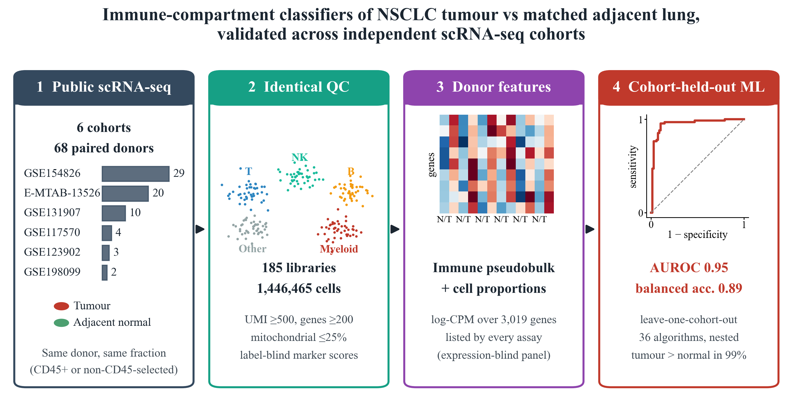

# scRNA2ML

**From public single-cell RNA-seq archives to cross-cohort validated, donor-level machine-learning classifiers — in one command.**

`scRNA2ML` downloads raw count matrices from GEO / ArrayExpress, harmonises heterogeneous deposits into one library manifest, runs an identical Seurat quality-control and annotation workflow on every library, aggregates cells into donor-level pseudobulk profiles and evaluates 36 classifier families under nested, leakage-safe validation schemes, including leave-one-cohort-out. It finishes by writing publication-ready tables and figures.

The bundled configuration reproduces a six-cohort study of non-small cell lung cancer (NSCLC) tumour versus matched non-tumour (adjacent) lung. The framework itself is disease-agnostic: new studies are a YAML file plus, where needed, one adapter function.

<p align="center">
  
</p>

---

## Contents

- [Design principles](#design-principles)
- [Pipeline overview](#pipeline-overview)
- [Installation](#installation)
- [Quick start](#quick-start)
- [Running individual stages](#running-individual-stages)
- [Configuration](#configuration)
- [Validation design](#validation-design)
- [Outputs](#outputs)
- [Adding a new dataset](#adding-a-new-dataset)
- [Compute requirements](#compute-requirements)
- [Reproducibility](#reproducibility)
- [Repository layout](#repository-layout)
- [Citation](#citation)
- [License](#license)

---

## Design principles

| Principle | How it is enforced |
|---|---|
| **The donor is the unit of analysis** | Cells are never classified individually. Each donor contributes one tumour and one adjacent-normal pseudobulk profile, and both always fall in the same cross-validation partition (asserted for every outer and inner split). |
| **No information leakage** | Imputation, variance filtering, univariate feature selection, scaling and model fitting all live inside a scikit-learn `Pipeline` that is refitted on training partitions only. Hyper-parameters and the algorithm itself are chosen by an inner loop that never sees the outer test set. |
| **Generalisation across studies, not just across donors** | The primary scheme holds out an entire cohort; inner tuning also holds out cohorts. |
| **Fixed primary model** | An L2-regularised logistic regression is designated as primary in code (`ml.PRIMARY`); a 36-model benchmark and nested algorithm selection are reported alongside it rather than replacing it. |
| **Identical processing for every library** | One R script, one parameter set, applied per library with checkpointing; every exclusion is logged with a reason. |
| **Comparable features across platforms** | Genes are kept only if they are listed in the deposited input of every library, so author-side gene filtering is treated as missing, not as zero expression. The rule uses gene lists only (never expression values or labels), and a sensitivity analysis rebuilds the panel and CPM denominator from the training cohorts of each held-out fold. |
| **Honest uncertainty** | Donor-level bootstrap confidence intervals, within-donor label-permutation tests that rerun the full nested procedure, and explicit batch-effect diagnostics. |
| **Resumable and auditable** | Downloads are size- and gzip-verified with SHA-256 manifests; every stage writes completion markers, and a JSON run log records timings, software versions, SHA-256 hashes of the configuration and code, and the git commit. |

## Pipeline overview

```
download ─► prepare ─► seurat ─► features ─► ml ─► analysis ─► report
```

| Stage | Module | What it does | Main outputs |
|---|---|---|---|
| `download` | `download.py` | Parallel, resumable `curl` downloads (GEO FTP, BioStudies/ArrayExpress), per-host rate limits, size and `gzip -t` integrity checks, SHA-256 manifest. | `data/raw/<cohort>/` |
| `prepare` | `adapters.py`, `R/split_gse131907.R` | Source-specific adapters convert each deposit (tar archives, dense text tables, RDS objects, hashtag-multiplexed runs, unfiltered CellRanger output) into standard per-library 10x matrices; apply inclusion rules; demultiplex hashtag oligos. | `data/prepared/libraries.tsv`, `exclusions.tsv` |
| `seurat` | `seurat.py`, `R/seurat_qc.R` | Per-library QC (UMI, gene and mitochondrial thresholds), normalisation, PCA, clustering, UMAP, marker-based broad annotation; exports whole-library and immune-compartment pseudobulk plus cell-type composition. | `results/seurat/<library>/`, `qc_audit.tsv` |
| `features` | `features.py` | Builds paired donor × tissue matrices: log1p CPM over the shared gene panel plus cell-type proportions, for each analysis compartment. | `results/features/<compartment>/` |
| `ml` | `ml.py`, `models.py`, `deep_models.py` | Nested evaluation of all models under every configured scheme, permutation tests, final interpretable model. | `results/ml/<compartment>/<scheme>/` |
| `analysis` | `analysis.py` | Paired random-effects meta-analysis, cohort (batch) predictability, feature-set ablation, subgroup performance, feature-selection stability, training-only gene-panel sensitivity analysis, technical-covariate negative control. | `results/analysis/<compartment>/` |
| `report` | `report.py`, `graphical.py` | Main and supplementary tables (TSV + Excel), figures (PDF, PNG 300 dpi, editable SVG), graphical abstract and a machine-readable summary. | `results/publication/` |

## Installation

Requirements: Linux or macOS, Python ≥ 3.10, R ≥ 4.3 with Seurat ≥ 5, `curl`.

**Conda (recommended — installs Python and R dependencies together)**

```bash
git clone https://github.com/<your-username>/scRNA2ML.git
cd scRNA2ML
conda env create -f environment.yml
conda activate scrna2ml
```

**pip (if R and Seurat are already installed)**

```bash
pip install -e .
Rscript -e 'install.packages(c("Seurat", "Matrix", "data.table", "jsonlite"))'
```

Check the installation:

```bash
scrna2ml run --help
```

## Quick start

Run the complete study end to end:

```bash
scrna2ml run --config config/nsclc.yaml
# equivalently: python -m scrna2ml run --config config/nsclc.yaml
```

The command is idempotent: if it is interrupted, rerunning it resumes from the last completed download, library and stage checkpoint.

For long runs, detach the process and follow the log:

```bash
nohup scrna2ml run --config config/nsclc.yaml > logs/run.log 2>&1 &
tail -f logs/run.log                     # live progress
cat results/run_log.jsonl                # finished stages, durations, versions
```

## Running individual stages

`--stages` accepts any comma-separated subset; stages always execute in pipeline order.

```bash
scrna2ml run --config config/nsclc.yaml --stages download,prepare
scrna2ml run --config config/nsclc.yaml --stages seurat
scrna2ml run --config config/nsclc.yaml --stages features,ml,analysis,report
scrna2ml run --config config/nsclc.yaml --stages report          # regenerate tables and figures only
```

| Option | Default | Description |
|---|---|---|
| `--config` | — | Study YAML (relative paths resolve against the repository root). |
| `--stages` | all | Subset of `download,prepare,seurat,features,ml,analysis,report`. |
| `--download-workers` | 8 | Concurrent downloads (per-host limits still apply). |

## Configuration

Everything study-specific lives in one YAML file. Annotated excerpt of [`config/nsclc.yaml`](config/nsclc.yaml):

```yaml
study:
  name: NSCLC_tumour_vs_adjacent_normal
  data_dir: data              # raw and prepared matrices
  results_dir: results        # all derived outputs
  seed: 42

datasets:                     # one entry per cohort; the key selects the adapter
  GSE117570:
    source: geo               # explicit file list
    files: [https://ftp.ncbi.nlm.nih.gov/geo/series/GSE117nnn/GSE117570/suppl/GSE117570_RAW.tar]
  GSE154826:
    source: geo_listing       # every file in a directory listing matching a regex
    listing: https://ftp.ncbi.nlm.nih.gov/geo/series/GSE154nnn/GSE154826/suppl/
    pattern: 'GSE154826_[A-Za-z0-9_]+\.(?:tar\.gz|csv\.gz)'

qc:                           # applied identically to every library
  min_counts: 500
  min_features: 200
  max_percent_mt: 25
  min_cells_per_sample: 30
  variable_features: 2000
  pca_dimensions: 30
  cluster_resolution: 0.4
  celltype_min_cells: 20
  workers: 4                  # libraries processed in parallel

features:
  min_cells: 50               # minimum compartment cells per tissue for a donor to be kept
  compartments: [immune, whole]

ml:
  select_k: [5, 10, 20, 50]   # SelectKBest grid, tuned in the inner loop
  outer_max_splits: 5         # donor-grouped outer folds (pooled / within schemes)
  inner_max_splits: 3
  bootstrap: 1000             # donor-level bootstrap resamples for 95% CIs
  permutations: 200           # within-donor label permutations
  n_jobs: 8
  within_min_donors: 8        # within-cohort CV only for cohorts this large
  schemes:
    immune: [loco, loco_centered, pooled, within]
    whole: [loco, pooled]
  permutation_schemes:
    immune: [loco, pooled]
    whole: [loco]
```

**Analysis compartments**

- `immune` — pseudobulk of cells annotated as T, NK, B, plasma, myeloid, dendritic or mast cells, plus immune cell-type proportions. Per donor, CD45⁺-sorted libraries are preferred, otherwise non-CD45-selected libraries (unsorted or erythrocyte-depleted only; `enrichment: unsorted` in the manifest); tumour and normal must come from the same fraction.
- `whole` — pseudobulk of all QC-passing cells from non-CD45-selected libraries only, plus all cell-type proportions.

## Validation design

| Scheme | Outer loop (performance estimate) | Inner loop (model and *k* selection) |
|---|---|---|
| `loco` | Leave one cohort out | Leave one of the remaining cohorts out |
| `loco_centered` | As `loco`, after centring features within each cohort (label-free, transductive batch adjustment) | Leave one cohort out |
| `pooled` | 5-fold donor-grouped CV across all cohorts | 3-fold donor-grouped CV |
| `within` | 5-fold donor-grouped CV inside each sufficiently large cohort | 3-fold donor-grouped CV |

Every candidate model is wrapped as

```
SimpleImputer(median) → VarianceThreshold → SelectKBest(f_classif, k) → StandardScaler → classifier
```

and tuned by `GridSearchCV` on balanced accuracy over the inner folds. **Nested algorithm selection** picks, in each outer fold, the candidate with the best inner score, so its outer performance is an unbiased estimate of the whole "try everything and keep the best" strategy.

**Model registry (36 candidates + a prior-only baseline).** Linear (logistic L2/L1/elastic net, ridge, SGD, perceptron, passive-aggressive, LDA, linear SVM), kernel and instance-based (RBF/polynomial SVM, Gaussian process, *k*-NN, nearest centroid), probabilistic (Gaussian/Bernoulli naive Bayes, QDA), tree ensembles (decision tree, random forest, extra trees, bagging, AdaBoost, gradient boosting, histogram gradient boosting, XGBoost, LightGBM, CatBoost), voting ensembles, and neural networks (scikit-learn MLP, FT-Transformer, tabular ResNet, RealMLP-style MLP; trained for a fixed number of epochs without an internal random validation split).

**Reported metrics.** Balanced accuracy, AUROC (pooled out-of-fold and mean per fold), sensitivity, specificity, Matthews correlation, macro-F1, Brier score and *paired concordance* — the fraction of donors whose tumour specimen receives a higher tumour score than their own normal specimen. 95% CIs come from resampling donors (both specimens together).

**Permutation test.** Tumour/normal labels are swapped at random within donors, and the complete nested procedure for the primary model is rerun for each permutation; *P* = (1 + #null ≥ observed) / (1 + *n*).

**Secondary analyses.** DerSimonian–Laird random-effects meta-analysis of within-donor paired differences per cohort with at least three donors (Benjamini–Hochberg FDR, sign concordance across the meta-analysed cohorts, *I*²; gene effects are differences on the log₂(1 + CPM) scale, not fold changes); cohort-of-origin predictability as a batch-effect diagnostic; ablation (proportions only / genes only / all features / each single proportion); subgroup performance by histology, sorting fraction and cohort; selection frequency of each feature across outer folds; a final model refitted on all cohorts for interpretation.

**Gene-panel sensitivity analysis.** In each leave-one-cohort-out fold the gene panel and CPM denominator are rebuilt from the training cohorts only. The held-out cohort is represented over the panel genes its own assay lists (CPM renormalised over them) and abstains if any selected gene is missing. Results are reported for all scored donors and for cohorts with full panel coverage, alongside the original predictions for the same donors.

**Technical-covariate negative control.** The primary model is run under leave-one-cohort-out on library-quality summaries only (median genes, UMIs and mitochondrial percentage per cell, fraction of unannotated cells; optionally cell and library counts) to measure how much tissue information is carried by sample quality alone.

## Outputs

```
results/
├── seurat/                         per-library QC objects, UMAPs, pseudobulk, composition; qc_audit.tsv
├── features/<compartment>/         units.tsv, X.tsv.gz, counts.tsv.gz, unit_exclusions.tsv, schema.json
├── ml/<compartment>/<scheme>/      oof_predictions.tsv, metrics.tsv, metrics_per_fold.tsv, splits.json,
│                                   selected_features.json, nested_selection.json, errors.json, status.json,
│                                   permutation_null.tsv, permutation_test.json
├── ml/<compartment>/               final_model.joblib, final_model_coefficients.tsv
├── analysis/<compartment>/         paired_meta_analysis.tsv, cohort_predictability.json, feature_set_ablation_loco.tsv,
│                                   subgroups_loco.tsv, selection_stability_loco.tsv,
│                                   fold_local_panel_{loco,oof}.tsv, fold_local_panel_summary.json,
│                                   technical_control_loco.json
├── publication/
│   ├── tables/                     Table1–2, S1–S12 (TSV) and tables.xlsx
│   ├── figures/                    Figure1–4, S1–S2 as PDF, PNG (300 dpi) and SVG (editable text)
│   └── key_numbers.json            every headline number, for programmatic manuscript checks
└── run_log.jsonl                   stage timings, software versions, config/code SHA-256 and git commit
```

| File | Content |
|---|---|
| `Table1_cohorts` | Cohort, reference, chemistry, sorting fractions, libraries, cells and paired donors per compartment |
| `Table2_performance` | Primary and nested-selection performance for every compartment × scheme |
| `S1` – `S4` | Library exclusions, per-library QC, analysed units, unit exclusions |
| `S5` | All models for every scheme |
| `S6` – `S10` | Meta-analysis, ablation, subgroups, selection stability, final-model coefficients |
| `S11` | Leave-one-cohort-out performance with a training-only gene panel, per held-out cohort (coverage, abstention) |
| `S12` | Technical-covariate negative control |

Figures use Times New Roman throughout; SVGs keep text as editable `<text>` elements and PDFs embed TrueType fonts.

## Adding a new dataset

1. **Declare the download** in the YAML under `datasets:` with `source: geo` (explicit `files:`), `geo_listing` or `biostudies_listing` (`listing:` URL plus `pattern:` regex).
2. **Write an adapter** in `scrna2ml/adapters.py` with the signature `adapter(raw: Path, out: Path) -> (records, exclusions)`:
   - read the raw deposit from `raw`;
   - write each library with `write_10x(out / <library>, matrix_genes_x_cells, genes, barcodes)` (raw integer counts are validated);
   - return one `record(cohort, library, donor, tissue, histology, enrichment, path, **extra)` per library, with `tissue` in `{Tumor, Normal}` (or your study's two classes) and `enrichment` such as `unsorted` or `CD45+`;
   - return excluded libraries as `{'cohort', 'library', 'reason'}` dictionaries.
3. **Register it** in the `ADAPTERS` dictionary under the same key as in the YAML.
4. Run `scrna2ml run --config <your.yaml>`; Seurat, features, ML and reporting need no changes.

Leave-one-cohort-out requires at least three cohorts; within-cohort CV is run only for cohorts with at least `within_min_donors` donors.

## Compute requirements

For the bundled six-cohort configuration (185 libraries):

| Resource | Approximate requirement |
|---|---|
| Disk | ~21 GB for raw and prepared data, ~14 GB for results |
| Memory | 32 GB minimum; 64 GB recommended (one deposit is a dense matrix converted per sample) |
| Wall time on a 10-core workstation | prepare ≈ 30 min, Seurat ≈ 25 min (4 workers), ML ≈ 30 min (8 jobs), analysis and report < 1 min; downloads depend on bandwidth |

Reduce `qc.workers` or `ml.n_jobs` on smaller machines; all stages resume from checkpoints.

## Reproducibility

- Fixed seeds for data splits, models, permutations and bootstraps (`study.seed`).
- Result-sensitive dependencies (NumPy, pandas, scikit-learn) are pinned in `environment.yml` and `pyproject.toml`; R `sessionInfo()` is written to `results/seurat/R_sessionInfo.txt`.
- SHA-256 checksums of every downloaded file in `data/raw/<cohort>/download_manifest.json`.
- Seurat checkpoints are keyed to a hash of the QC parameters, so changing a threshold reprocesses every library.
- `splits.json` records the donors in every outer and inner fold; `errors.json` records any failed fit with its traceback.
- `results/run_log.jsonl` records, for every stage, the SHA-256 of the configuration file and of the package source, and the git commit (suffixed `-dirty` if the working tree had uncommitted changes).
- To apply a trained model to a new cohort, lock the gene panel (the `gene::` columns of `results/features/<compartment>/X.tsv.gz`, which `final_model.joblib` expects), the CPM denominator and the coverage rule before examining the new data.

## Repository layout

```
scRNA2ML/
├── config/nsclc.yaml              study configuration
├── scrna2ml/
│   ├── __main__.py                command-line interface and stage runner
│   ├── config.py                  configuration loading
│   ├── download.py                verified, resumable downloads
│   ├── adapters.py                source-specific harmonisation and inclusion rules
│   ├── seurat.py                  manifest construction, R driver, QC audit
│   ├── R/seurat_qc.R              per-library QC, annotation and pseudobulk export
│   ├── R/split_gse131907.R        per-sample extraction from a combined RDS deposit
│   ├── features.py                paired donor-level feature matrices
│   ├── models.py                  classifier registry
│   ├── deep_models.py             scikit-learn wrapper for tabular neural networks
│   ├── tabular_architectures.py   FT-Transformer, ResNet and MLP definitions
│   ├── ml.py                      nested validation, permutation tests, final model
│   ├── analysis.py                meta-analysis, batch diagnostics, ablation, subgroups, stability, sensitivity controls
│   ├── report.py                  tables and figures
│   └── graphical.py               graphical abstract
├── docs/figures/                  images used in this README
├── environment.yml
├── pyproject.toml
├── CITATION.cff
└── LICENSE
```

## Citation

If you use this software, please cite it using the metadata in [`CITATION.cff`](CITATION.cff), and cite the original publications of every dataset you analyse (listed per cohort in the configuration file).

## License

Released under the [MIT License](LICENSE). Public datasets retain the terms of their original repositories.
